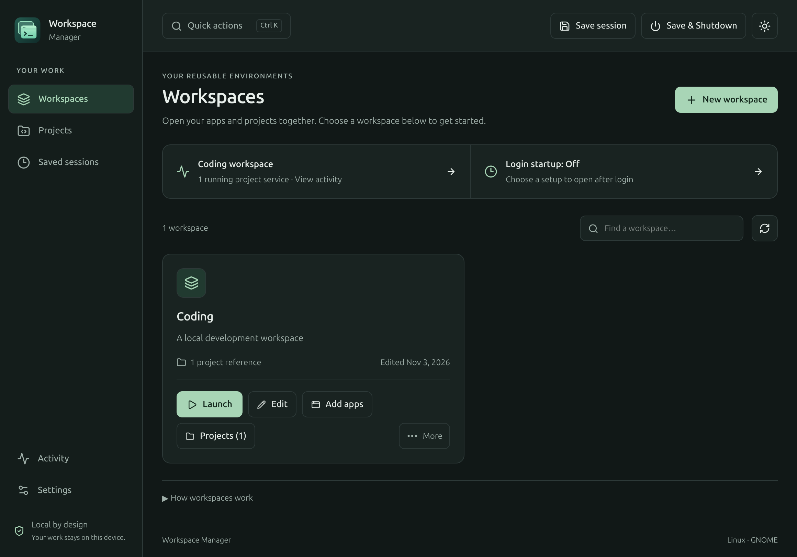

# Workspace Manager

A local Linux developer workspace manager built with Go, Wails v3, React and TypeScript.



[Activity](docs/screenshots/activity.png) · [Sessions](docs/screenshots/sessions.png)
— captured from an isolated native test workspace.

## Features

- Create workspaces and Go, Node/TypeScript, Next.js, Python or FastAPI projects.
- Import projects; review literal commands, editors, environment references and previews.
- Launch ordered applications/projects with delays, readiness checks and duplicate prevention.
- Keep managed servers running after the GUI closes; reconnect to bounded logs and stop controls.
- Save, restore, branch and revise sessions with recoverable history.
- Configure reviewed fixed, session restore or hybrid login startup.
- Save and verify a snapshot before gracefully stopping managed services and opening normal GNOME shutdown.

V1 implementation is available. Real logout/login, power-off, X11, assistive-technology
and clean-system installation acceptance checks remain pending; see [roadmap](docs/roadmap.md).
Snapshots preserve supported launch metadata, not source files, unsaved documents,
arbitrary browser tabs or terminal history. Project execution always requires approval.

## Build and run

Ubuntu 26.04 GNOME, Linux AMD64; Go 1.26+, Node.js 24+ and npm.

```bash
sudo apt install build-essential pkg-config libgtk-4-dev libwebkitgtk-6.0-dev desktop-file-utils
mkdir -p .tools/bin
GOBIN="$PWD/.tools/bin" go install github.com/wailsapp/wails/v3/cmd/wails3@v3.0.0
export PATH="$PWD/.tools/bin:$PATH"
npm --prefix frontend ci
wails3 build
./bin/workspace-manager
```

Use `wails3 dev` for development. Configuration and state follow XDG directories.
Environment files accept literal `KEY=VALUE` lines, with optional enclosing quotes;
there is no shell expansion. Output redaction is best effort; avoid printing secrets.

## Test and package

```bash
export PATH="$PWD/.tools/bin:$PATH"
wails3 task test
wails3 task package
```

The package is `bin/workspace-manager_1.0.0_amd64.deb`. Packaging never installs it.

```bash
sudo apt install ./bin/workspace-manager_1.0.0_amd64.deb
# Disable login startup and stop managed workers in Activity before uninstalling.
sudo apt remove workspace-manager
```

Uninstall preserves configuration, snapshots and project directories. The GUI closes
independently of managed workers. `workspace-manager --status` prints controller
state; `--stop-controller` disconnects the controller while preserving workers.

## Daily workflow

1. Start in Workspaces. Add your apps/projects, then launch the workspace from its card.
   `Ctrl+K` opens quick actions from any screen.
2. Use Projects to create or import code; use Saved sessions to resume a captured setup.
3. Approve project startup configuration, then review and launch the workspace.
4. Use Activity for progress and output. App browsing and diagnostics live in Settings.
5. Save a named session using the top bar; a name is suggested for you. Restore it or save an independent branch from Sessions.
6. Review login startup in Settings. Save & Shutdown is available from the top bar.

Native fixture checks: build with `go build -tags production,mcp -o bin/workspace-manager-smoke .`,
then run `python3 scripts/native-smoke.py --lifecycle-only` in a graphical session.
Use `--login-only` to check all startup modes and desktop session restore.
These use owned fixtures and never power off. Production builds have no MCP endpoint.
Add `--screenshots` to refresh the native screenshots. Run `python3 scripts/check-package.py`
after packaging to verify isolated unpack/removal and the production CLI.

[Architecture](docs/architecture.md) · [MIT license](LICENSE)
